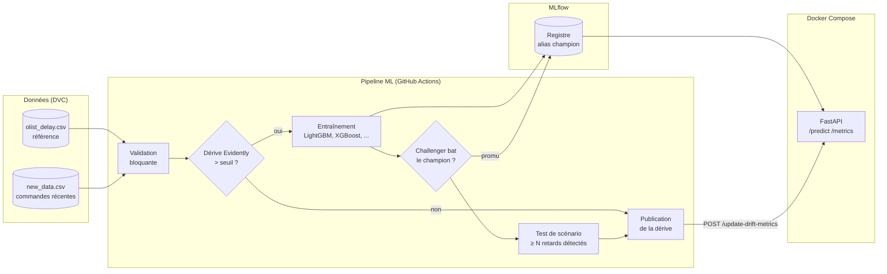

# 🚚 Prédiction des retards de livraison e-commerce — plateforme MLOps

[](https://www.python.org/)
[](https://fastapi.tiangolo.com/)
[](https://dvc.org/)
[](https://mlflow.org/)
[](https://www.evidentlyai.com/)
[](https://www.docker.com/)
[](https://github.com/features/actions)

Plateforme de bout en bout pour **prédire, dès la commande, si une livraison e-commerce arrivera
en retard** par rapport à la date promise au client : données versionnées avec DVC, expériences
suivies dans MLflow, détection de dérive avec Evidently, ré-entraînement déclenché par la dérive,
promotion contrôlée du modèle (champion / challenger), API FastAPI conteneurisée et intégration
continue avec GitHub Actions.

---

## Sommaire

1. [Contexte et problématique](#-contexte-et-problématique)
2. [Idée générale](#-idée-générale)
3. [Dataset](#-dataset)
4. [Architecture](#️-architecture)
5. [Démarrage rapide](#-démarrage-rapide)
6. [Guide pas à pas](#-guide-pas-à-pas)
7. [Structure du dépôt](#-structure-du-dépôt)
8. [Cycle de vie du modèle](#-cycle-de-vie-du-modèle)
9. [API](#-api)
10. [Monitoring](#-monitoring)
11. [Configuration](#️-configuration)
12. [Tests et quality gates](#-tests-et-quality-gates)
13. [Limites connues](#️-limites-connues)
14. [Planning et état d'avancement](#-planning-et-état-davancement)
15. [Dépannage](#-dépannage)
16. [Auteur](#-auteur)

---

## 🎯 Contexte et problématique

Lorsqu'un client passe commande, une date de livraison lui est promise. Si le colis arrive après
cette date, le client est déçu : mauvais avis, demande de remboursement, perte de fidélité.
Aujourd'hui, la boutique découvre le retard **après** qu'il s'est produit.

> **Problématique :** comment prédire de façon fiable les retards de livraison dès la commande, et
> comment maintenir ce modèle performant dans le temps lorsque les données évoluent ?

Elle se décompose en quatre défis :

| Défi | Description | Réponse MLOps |
|---|---|---|
| **Classes déséquilibrées** | Les retards sont minoritaires (de l'ordre de 8 % des commandes, à confirmer à l'analyse exploratoire) : l'accuracy est trompeuse | Sélection par **PR-AUC**, seuil de décision explicite |
| **Coût asymétrique** | Un retard non prévenu coûte plus cher qu'une fausse alerte | Seuil choisi par **coût**, pas seulement par F1 |
| **Dérive des données** | Volumes, destinations et délais changent selon les périodes (par exemple le Black Friday 2017) | Détection avec **Evidently**, ré-entraînement déclenché |
| **Étiquettes tardives** | On ne sait si une commande est en retard qu'à la livraison, parfois des semaines après | Ré-entraînement sur les commandes **dont l'étiquette est connue**, champion / challenger |

### Ce que l'entreprise peut faire avec la prédiction

* prévenir le client à l'avance ou lui proposer une compensation ciblée ;
* changer de transporteur ou alerter un vendeur peu fiable ;
* afficher une date de livraison plus réaliste pour les commandes à risque.

---

## 💡 Idée générale

1. Pour chaque commande, on calcule des **features connues au moment de l'achat** (distance
   vendeur-client, délai promis, poids, frais de port, jour et heure…).
2. Un modèle (LightGBM, XGBoost…) estime la **probabilité de retard**.
3. Une règle de décision compare cette probabilité à un **seuil** choisi pour minimiser le coût
   (retard non prévenu contre fausse alerte).
4. Un pipeline automatique surveille les nouvelles données : validation, dérive, ré-entraînement,
   comparaison au modèle en production, promotion ou rejet.
5. L'API sert le modèle « champion » et expose ses métriques.

---

## 📦 Dataset

**Brazilian E-Commerce Public Dataset by Olist** (Kaggle) :
<https://www.kaggle.com/datasets/olistbr/brazilian-ecommerce>

Environ 100 000 commandes anonymisées passées sur la place de marché Olist (Brésil) entre 2016 et
2018, réparties dans 9 fichiers CSV reliés par des identifiants. La licence indiquée par plusieurs
sources est **CC BY-NC-SA 4.0** (usage non commercial) : à vérifier sur la page Kaggle.

### Fichiers

| Fichier | Utilisation |
|---|---|
| `olist_orders_dataset.csv` | table centrale : statut et dates (achat, livraison réelle, livraison promise) |
| `olist_order_items_dataset.csv` | articles, vendeur, prix, frais de port, date limite d'expédition |
| `olist_customers_dataset.csv` | État et code postal du client |
| `olist_sellers_dataset.csv` | État et code postal du vendeur |
| `olist_products_dataset.csv` | poids du produit |
| `olist_geolocation_dataset.csv` | latitude et longitude par préfixe de code postal (distance) |
| `olist_order_reviews_dataset.csv` | **non utilisé** : les avis sont écrits après la livraison (fuite de données) |
| `olist_order_payments_dataset.csv`, `product_category_name_translation.csv` | non utilisés dans le MVP |

### Cible

```text
retard = 1 si order_delivered_customer_date > order_estimated_delivery_date, sinon 0
```

Seules les commandes `delivered` avec une date de livraison renseignée sont conservées.

### Features (connues à la commande)

| Famille | Features |
|---|---|
| Temps | `month`, `dayofweek`, `hour` |
| Géographie | `distance_km` (Haversine), `same_state`, `customer_state`, `seller_state` |
| Promesse | `promised_days` (date promise moins date d'achat) |
| Vendeur | `seller_margin_days` (date limite d'expédition moins date d'achat) |
| Commande | `n_items`, `n_sellers`, `price_sum`, `freight_sum`, `weight_g` |

### Pièges traités

| Risque | Parade |
|---|---|
| **Fuite de données** : dates de livraison réelle, d'expédition au transporteur, avis | seules les informations connues à la commande sont gardées |
| **Doublons après jointure** : une commande a plusieurs articles | agrégation par commande |
| **Découpage aléatoire trop optimiste** | train / validation / test **dans l'ordre du temps** |
| Valeurs manquantes (commandes annulées ou non livrées) | filtre sur `delivered` |

---

## 🏗️ Architecture



Trois flux à retenir :

* **Données → modèle** : la dérive déclenche l'entraînement, mais un nouveau modèle n'est promu que
  s'il bat le champion, puis seulement s'il passe le test de scénario.
* **Modèle → production** : l'API charge le modèle portant l'alias `champion` dans le registre
  MLflow, pas un fichier local arbitraire.
* **Production → supervision** : l'API expose ses métriques ; la dérive publiée par le pipeline est
  visible via l'API.

---

## 🚀 Démarrage rapide

```bash
git clone https://github.com/<user>/<repo>.git && cd <repo>
python3.12 -m venv .venv && source .venv/bin/activate      # Windows : .venv\Scripts\activate
pip install -r requirements.txt
```

1. Télécharger le dataset sur Kaggle et placer les 9 CSV dans `data/raws/`.
2. Construire le tableau d'entraînement (une ligne par commande) :

```bash
python build_dataset.py            # écrit data/processed/olist_delay.csv
```

3. Lancer les notebooks `01` → `04`, puis démarrer l'API :

```bash
docker compose up -d --build       # http://localhost:8000/docs
```

---

## 📘 Guide pas à pas

### 1. Outils

| Outil | Version | Utilisé pour |
|---|---|---|
| Git | récente | versionnement du code |
| Python | 3.12 (3.11 accepté) | notebooks, pipeline, API, tests |
| Docker + Docker Compose v2 | récente | exécution de l'API |
| Compte Kaggle | — | téléchargement du dataset |
| Compte DagsHub (facultatif) | — | remote DVC et serveur MLflow distants |

> macOS : LightGBM et XGBoost ont besoin d'OpenMP → `brew install libomp`.

### 2. Environnement Python

```bash
python3.12 -m venv .venv
source .venv/bin/activate                  # Windows : .venv\Scripts\activate
pip install --upgrade pip
pip install -r requirements.txt
python -c "import lightgbm, xgboost, mlflow, evidently; print('OK')"
```

### 3. Configuration

```bash
cp .env.example .env
```

| Variable | Rôle |
|---|---|
| `MLFLOW_TRACKING_URI` | vide = MLflow local (`mlflow.db` + `mlruns/`) ; sinon URL du serveur |
| `DAGSHUB_USER`, `DAGSHUB_TOKEN` | uniquement si DVC et MLflow sont distants |

Le fichier `.env` n'est **jamais commité**.

### 4. Données

```bash
pip install kaggle                         # jeton : Kaggle > Settings > API > Create New Token
kaggle datasets download -d olistbr/brazilian-ecommerce -p data/raws --unzip
python build_dataset.py
dvc init                                   # une seule fois
dvc add data/processed/olist_delay.csv
git add data/processed/olist_delay.csv.dvc data/processed/.gitignore && git commit -m "données : version initiale"
```

Les CSV bruts et le tableau final ne sont **pas** commités dans Git : seul le pointeur `.dvc` l'est.

### 5. Notebooks

| Notebook | Rôle |
|---|---|
| `01_eda` | volumes par mois, taux de retard par État et par distance, valeurs manquantes |
| `02_preprocessing` | découpage **temporel** train / validation / test, encodage des États, sauvegarde du préprocesseur |
| `03_modeling` | baseline, LightGBM, XGBoost ; sélection par **PR-AUC** sur la validation ; seuil de décision par coût ; un run MLflow par modèle |
| `04_mlflow_registry` | enregistrement du meilleur run, alias `champion`, export du modèle servi |

### 6. API en local

```bash
docker compose up -d --build
docker compose ps                          # « api » doit passer à healthy
docker compose logs -f api
docker compose down
```

Sans Docker : `uvicorn backend.src.api:app --reload --port 8000`.

---

## 📁 Structure du dépôt

```text
.
├── build_dataset.py               # jointure des 9 CSV -> une ligne par commande, cible « retard »
├── backend/
│   ├── src/api.py                 # API FastAPI : prédiction, sondes, métriques, dérive
│   ├── src/preprocessing.py       # features et encodage, partagés entraînement / API
│   ├── Dockerfile                 # multi-stage, utilisateur non-root, HEALTHCHECK
│   └── requirements.txt           # dépendances de service
├── pipeline/
│   ├── validate_data.py           # validation bloquante des nouvelles données
│   ├── drift_detection.py         # dérive Evidently
│   ├── train_model.py             # entraînement, sélection sur validation (PR-AUC)
│   ├── register_best_model.py     # champion / challenger, registre MLflow
│   ├── publish_drift.py           # publication de la dérive vers l'API
│   └── simulate_new_data.py       # rejoue les commandes récentes (démonstration)
├── notebooks/                     # 01 EDA → 02 préprocessing → 03 modélisation → 04 registre
├── test/                          # tests pytest et test de scénario
├── .github/workflows/             # pipeline ML et construction de l'image
├── data/                          # raws/ et processed/ (versionnés par DVC, jamais par Git)
├── docker-compose.yml
├── requirements.txt               # dépendances de développement et d'entraînement
└── .env.example                   # modèle du fichier de secrets local
```

---

## 🔁 Cycle de vie du modèle

### Pipeline ML (GitHub Actions)

| # | Étape | Condition | Bloquante |
|---|---|---|---|
| 1 | Récupération du code et des données (`dvc pull`) | toujours | oui |
| 2 | **Validation des données** : schéma, valeurs nulles, bornes, États connus | toujours | **oui** |
| 3 | **Dérive** (Evidently) sur `distance_km`, `promised_days`, `freight_sum`, `weight_g`, `customer_state`, `month` | toujours | — |
| 4 | **Entraînement** : LightGBM, XGBoost, RandomForest | dérive > seuil | oui |
| 5 | **Champion / challenger** | dérive | oui |
| 6 | **Test de scénario** : ≥ `MIN_DETECTED` retards détectés sur un jeu fixe | dérive | **oui** |
| 7 | Publication de la dérive vers l'API | toujours | oui |

### Champion / challenger

* Le **challenger** est le meilleur run du lot d'entraînement courant selon `val_pr_auc`.
* Le **champion** est la version du modèle enregistré portant l'alias `champion`.
* Le challenger n'est promu que si `val_pr_auc(challenger) > val_pr_auc(champion) + MIN_IMPROVEMENT`.
  Sinon le champion reste en place.
* La décision et sa raison sont écrites dans `artifacts/promotion.json`, archivé par le workflow.

### Règle de décision (seuil par coût)

Le seuil `t` est choisi sur la **validation** pour minimiser :

```text
coût(t) = COST_MISSED_LATE × (retards non détectés) + COST_FALSE_ALERT × (fausses alertes)
```

Les deux coûts sont des **hypothèses métier** (valeurs par défaut dans la configuration) à ajuster
selon l'entreprise. Ordre de priorité du seuil appliqué par l'API :
`DECISION_THRESHOLD` (variable d'environnement) › `threshold` de `metadata.json` › `0,5`.

### Étiquettes tardives

Le label d'une commande n'est connu qu'à sa livraison. Le ré-entraînement n'utilise donc que les
commandes **livrées avant la date de coupure** du lot ; les commandes encore en transit sont
exclues, pour ne pas fabriquer de fausses étiquettes.

---

## 📡 API

| Méthode | Endpoint | Description |
|---|---|---|
| `GET` | `/live` | sonde de vie : le processus répond |
| `GET` | `/health` | sonde de disponibilité : **503** tant que le modèle n'est pas chargé |
| `GET` | `/model-info` | modèle servi : nom, version du registre, run MLflow, seuil |
| `POST` | `/predict` | une commande ou une liste ; renvoie `predictions`, `probabilities`, `threshold` |
| `GET` | `/metrics` | métriques au format Prometheus |
| `GET` | `/drift-status` | dernière dérive publiée |
| `POST` | `/update-drift-metrics` 🔒 | réservé au pipeline (jeton si `API_ADMIN_TOKEN` est défini) |

Exemple :

```bash
curl -s -X POST http://localhost:8000/predict -H 'Content-Type: application/json' -d '{
  "customer_state": "RJ", "seller_state": "SP", "same_state": 0, "distance_km": 430.5,
  "promised_days": 18.0, "seller_margin_days": 3.0, "n_items": 2, "n_sellers": 1,
  "price_sum": 129.9, "freight_sum": 24.3, "weight_g": 1800, "month": 11, "dayofweek": 4, "hour": 21}'
# réponse : {"predictions": [0 ou 1], "probabilities": [p], "threshold": <seuil appliqué>, "count": 1}
```

Documentation interactive : <http://localhost:8000/docs>.

---

## 📈 Monitoring

| Métrique | Type | Signification |
|---|---|---|
| `delay_predictions_total{result}` | Counter | prédictions `late` / `on_time` |
| `delay_rate_current` | Gauge | taux de retards prédits sur les 1 000 dernières prédictions |
| `delay_prediction_latency_seconds` | Histogram | latence de `/predict` |
| `delay_decision_threshold` | Gauge | seuil de décision appliqué |
| `delay_model_loaded`, `delay_model_version_info` | Gauge | état et version du modèle servi |
| `delay_drift_score`, `delay_drift_detected` | Gauge | dernière dérive publiée par le pipeline |

Alertes prévues (Prometheus, **optionnel**) : taux de retards prédits anormalement élevé, dérive
détectée, latence p99 élevée, dernier build du pipeline en échec.

---

## ⚙️ Configuration

| Variable | Où | Rôle | Défaut |
|---|---|---|---|
| `MODEL_REGISTRY_DIR` | API | dossier du modèle exporté et de `metadata.json` | `artifacts/model` |
| `DECISION_THRESHOLD` | API, test de scénario | force le seuil de décision | seuil de `metadata.json`, sinon `0.5` |
| `COST_MISSED_LATE` | entraînement | coût d'un retard non détecté | `5` (hypothèse) |
| `COST_FALSE_ALERT` | entraînement | coût d'une fausse alerte | `1` (hypothèse) |
| `DRIFT_THRESHOLD` | pipeline | part de features dérivées déclenchant l'entraînement | `0.3` |
| `MIN_IMPROVEMENT` | champion / challenger | marge de PR-AUC exigée | `0.0` |
| `MIN_DETECTED` | test de scénario | retards détectés minimaux sur le jeu fixe | à fixer après l'EDA |
| `MIN_NEW_ROWS` | validation | taille minimale de `new_data.csv` | `1000` |
| `API_ADMIN_TOKEN` | API, pipeline | jeton des endpoints d'écriture | désactivé |
| `MLFLOW_TRACKING_URI` | notebooks, pipeline | serveur MLflow | SQLite local si vide |

---

## ✅ Tests et quality gates

```bash
pytest test/
```

| Fichier | Ce qu'il vérifie |
|---|---|
| `test/test_api_mock.py` | endpoints, seuil de décision, `/health` en 503 sans modèle, jeton |
| `test/test_pipeline_scripts.py` | règle champion / challenger, validation des données |
| `test/test_delay_scenario.py` | jeu fixe de commandes à risque : **échoue sous `MIN_DETECTED` détections** |

Le workflow GitHub Actions lance les tests à chaque commit et bloque la promotion si un gate échoue.

---

## ⚠️ Limites connues

* **Un seul pays, une seule période** (Brésil, 2016-2018) : le modèle ne se généralise pas tel quel à
  un autre contexte logistique.
* **Dérive limitée à environ deux ans** avec un événement marqué (Black Friday 2017) : la démonstration
  est réelle mais courte.
* **Les coûts de décision sont des hypothèses** : sans données financières réelles, le seuil par coût
  illustre la méthode plus qu'il ne chiffre une économie.
* **L'historique du vendeur** (taux de retard passé) n'est exploitable que s'il est calculé
  uniquement sur des commandes antérieures à celle prédite, sous peine de fuite de données.
* **Le ré-entraînement dépend du retour d'étiquettes** : une commande n'est utilisable qu'une fois livrée.
* **Rejeu, pas production** : les nouvelles données sont rejouées depuis l'historique ; il n'y a ni
  trafic réel ni latence réelle.
* **Licence non commerciale** du dataset : le projet est pédagogique.

---

## 🗓️ Planning et état d'avancement

Périmètre MVP prévu pour **un mois** (≈ 10 h par semaine). Jenkins, Kubernetes et Prometheus sont
volontairement laissés en perspectives.

| Semaine | Contenu | État |
|---|---|---|
| 1 | Données : jointure des tables, cible, features, découpage temporel, DVC, notebooks 01-02 | ☐ |
| 2 | Modélisation : baseline, LightGBM, XGBoost, PR-AUC, seuil par coût, MLflow, registre, notebooks 03-04 | ☐ |
| 3 | Pipeline : validation, dérive Evidently, champion / challenger, test de scénario, GitHub Actions | ☐ |
| 4 | API FastAPI, Docker Compose, tests pytest, démonstration de dérive, finition du README | ☐ |

`build_dataset.py` (jointure et construction de la cible) est disponible ; le reste est à réaliser.

### Perspectives

Déploiement Kubernetes, supervision Prometheus et Alertmanager, interface web, historique du vendeur
sans fuite, comparaison avec un modèle de régression du délai (en jours) au lieu d'une classification.

---

## 🔧 Dépannage

| Symptôme | Cause probable | Solution |
|---|---|---|
| `SyntaxError` dans `build_dataset.py` | caractères perdus au copier-coller (`>`, guillemets, `/`) | télécharger le fichier au lieu de le copier |
| `FileNotFoundError ... olist_orders_dataset.csv` | CSV absents de `data/raws/` | placer les 9 fichiers ou passer le dossier en argument |
| `/health` renvoie `503` | modèle absent ou non chargé | vérifier `docker compose logs api` et `MODEL_REGISTRY_DIR` |
| `dvc pull` : `does not exist as an output` | aucune version des données n'a encore été poussée | exécuter l'étape 4 puis `dvc push` |
| `Library not loaded: libomp.dylib` | OpenMP absent (macOS) | `brew install libomp` |
| Erreur `401` ou `403` avec DVC ou MLflow | identifiants ou droits | vérifier `.env` et `dvc remote modify --local` |

---

## 📝 Auteur

**Amrou Amira** — ENET'Com, projet MLOps.

Données : Olist, *Brazilian E-Commerce Public Dataset by Olist*, Kaggle.
